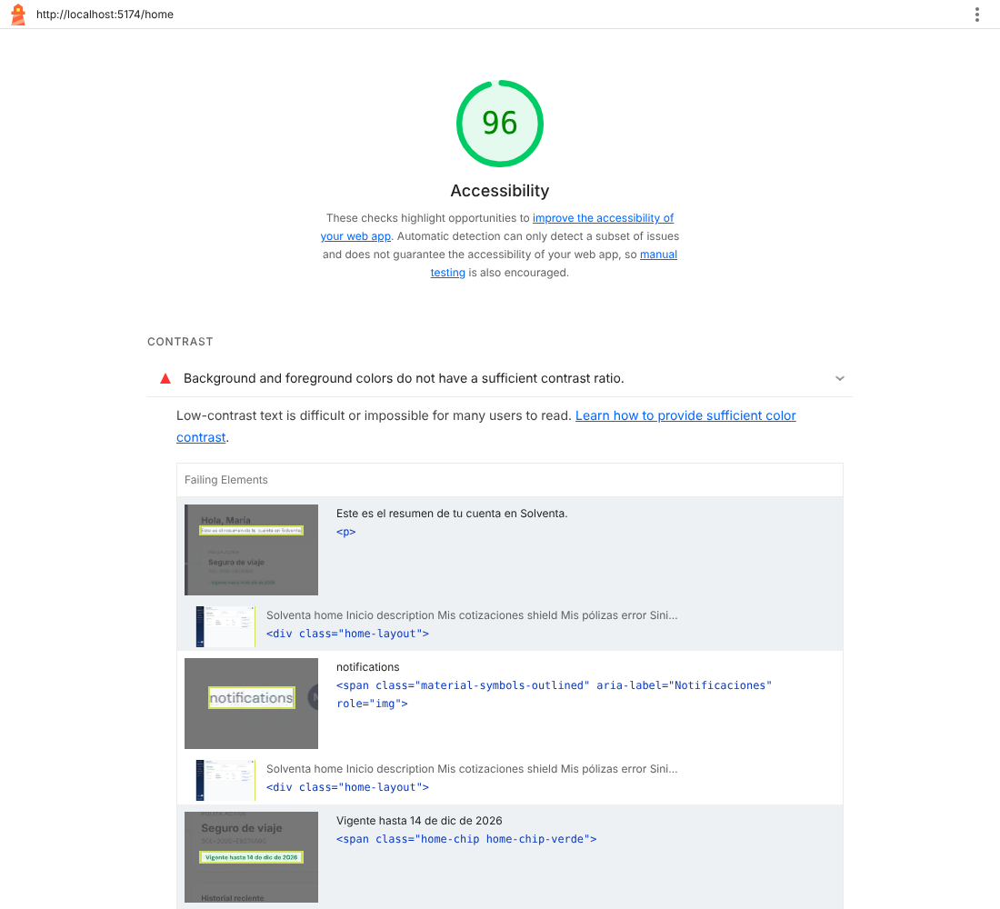
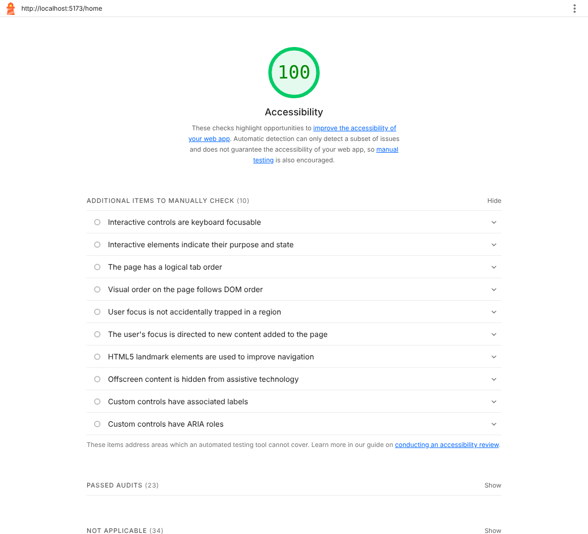
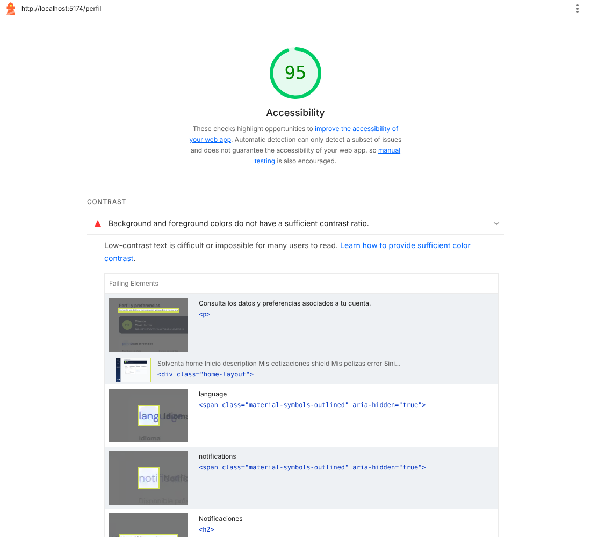
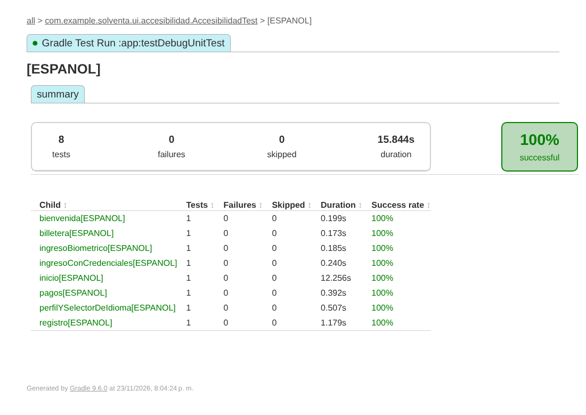
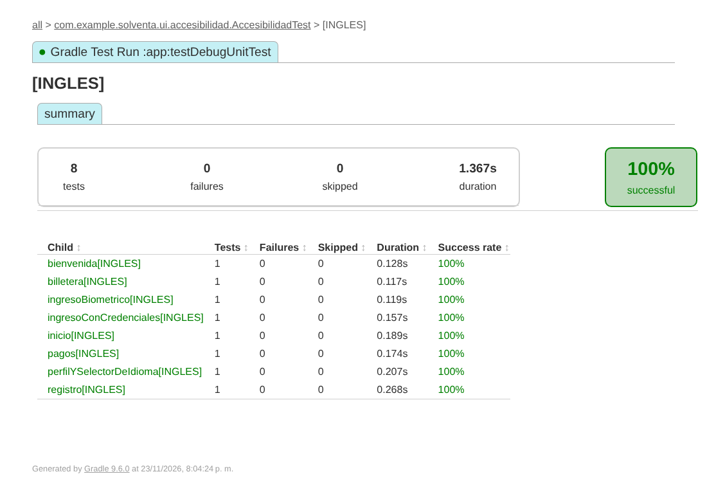
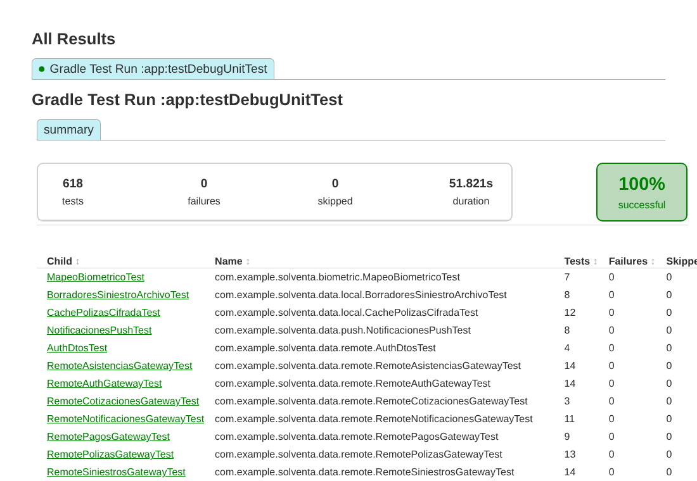

# Evidencias de accesibilidad

Ejecución del 23 de noviembre de 2026 contra el backend local, con una clienta que tiene póliza
vigente y un siniestro registrado. Se compara la web **antes** (rama `feat/internacionalizacion`) y
**después** (rama `feat/accesibilidad-postman`) de las correcciones.

## Resultado

| Pantalla | axe antes (es) | axe antes (en) | axe después (es) | axe después (en) | Reglas incumplidas antes | Lighthouse antes → después |
| --- | ---: | ---: | ---: | ---: | --- | ---: |
| `/login` | 0 | 0 | 0 | 0 | — | 100 → 100 |
| `/registro` | 1 | 1 | 0 | 0 | `color-contrast` | 94 → 100 |
| `/home` | 8 | 8 | 0 | 0 | `color-contrast`, `label-content-name-mismatch` | 96 → 100 |
| `/polizas` | 2 | 2 | 0 | 0 | `color-contrast` | 95 → 100 |
| `/cotizar` | 1 | 1 | 0 | 0 | `color-contrast` | 95 → 100 |
| `/cotizaciones` | 2 | 2 | 0 | 0 | `color-contrast` | 95 → 100 |
| `/siniestros` | 2 | 2 | 0 | 0 | `color-contrast` | 95 → 100 |
| `/siniestros/nuevo` | 1 | 1 | 0 | 0 | `color-contrast` | 95 → 100 |
| `/pagos` | 2 | 2 | 0 | 0 | `color-contrast` | 95 → 100 |
| `/perfil` | 5 | 5 | 0 | 0 | `color-contrast` | 95 → 100 |
| **Total** | **24** | **24** | **0** | **0** | | |

- **axe-core** (reglas WCAG 2.0/2.1 A y AA): número de elementos con violaciones por pantalla. Pasa
  de 24 elementos por idioma a 0.
- **Lighthouse** (categoría *Accessibility*, escritorio): todas las pantallas quedan en 100.

## Prueba automática (Playwright + axe)

[ejecucion-axe-playwright.txt](ejecucion-axe-playwright.txt): las 6 pruebas de
`web/e2e/accesibilidad/accesibilidad.spec.ts` pasan (10 pantallas × 2 idiomas).

```
  ✓  1 [chromium] › accesibilidad WCAG 2.1 AA (es) › sin violaciones en /login
  ✓  2 [chromium] › accesibilidad WCAG 2.1 AA (es) › sin violaciones en /registro
  ✓  3 [chromium] › accesibilidad WCAG 2.1 AA (es) › sin violaciones en las pantallas del cliente
  ✓  4 [chromium] › accesibilidad WCAG 2.1 AA (en) › sin violaciones en /login
  ✓  5 [chromium] › accesibilidad WCAG 2.1 AA (en) › sin violaciones en /registro
  ✓  6 [chromium] › accesibilidad WCAG 2.1 AA (en) › sin violaciones en las pantallas del cliente
  6 passed (31.2s)
```

La prueba se comprobó en las dos direcciones: con el color de texto secundario anterior
(`#69758b`) falla, y con el corregido pasa.

## Lighthouse

| Inicio, antes (96) | Inicio, después (100) |
| --- | --- |
|  |  |

| Perfil, antes (95) | Perfil, después (100) |
| --- | --- |
|  |  |

## Android

`AccesibilidadTest` (Robolectric) revisa la semántica que anuncia TalkBack en 8 pantallas, en español e
inglés: nombre en cada elemento táctil, etiqueta en cada campo y tamaño mínimo de toque.

| Ejecución | Resultado |
| --- | --- |
| Primera, antes de corregir | 6 de 16 pruebas fallan: registro, ingreso con credenciales e ingreso biométrico, en los dos idiomas |
| Después de corregir | 16 de 16 pasan; la suite completa de Android (618 pruebas) también pasa |

Problemas encontrados en la primera ejecución (iguales en inglés):

```
Registro: elemento táctil sin nombre accesible (campo "Tipo de documento")
Registro: elemento táctil sin nombre accesible (campo "Fecha de nacimiento")
Registro: elemento táctil sin nombre accesible (casilla de términos)
Ingreso con credenciales: '¿Olvidaste tu contraseña?' mide 363×35 dp
Ingreso biométrico: '¿Aún no tienes cuenta? Crear una' mide 32×35 dp
```

Las correcciones están en [docs/accesibilidad.md](../../accesibilidad.md#android).

| Español (8/8) | Inglés (8/8) |
| --- | --- |
|  |  |



## Archivos

| Archivo | Contenido |
| --- | --- |
| [resultados-axe.json](resultados-axe.json) | Violaciones, reglas aprobadas y elementos revisados por pantalla, idioma y versión |
| [resultados-lighthouse.json](resultados-lighthouse.json) | Puntaje y auditorías fallidas por pantalla y versión |
| [ejecucion-axe-playwright.txt](ejecucion-axe-playwright.txt) | Salida de la prueba automática web |
| [android-resultados-junit.xml](android-resultados-junit.xml) | Resultado JUnit de `AccesibilidadTest` (16 pruebas, 0 fallas) |

Las correcciones y el método están en [docs/accesibilidad.md](../../accesibilidad.md).

## Cómo repetirlo

```bash
cd android
./gradlew testDebugUnitTest --tests "com.example.solventa.ui.accesibilidad.AccesibilidadTest"

cd ../web
VITE_API_URL=http://localhost:8000 E2E_BACKEND_LOG=/tmp/backend.log npx playwright test e2e/accesibilidad
```

Para Lighthouse: inicie sesión en Chrome, abra DevTools → *Lighthouse*, marque solo *Accessibility* y
*Desktop*, y analice cada pantalla.
