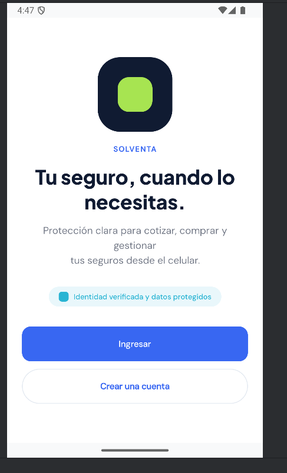
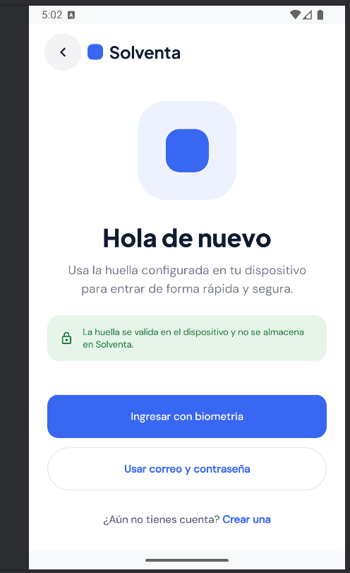
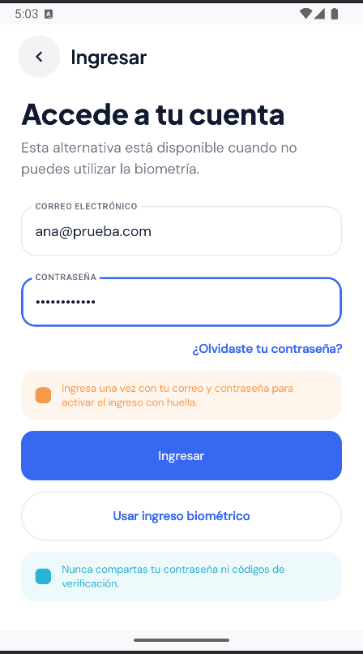
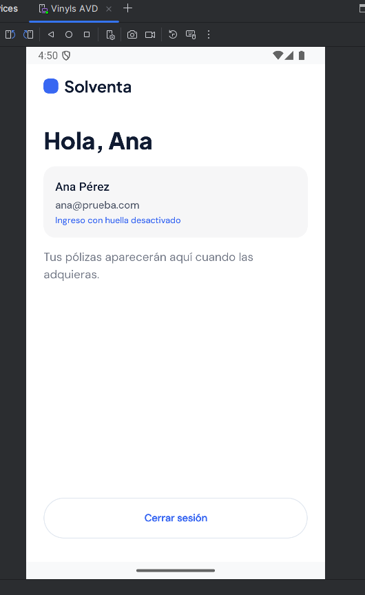
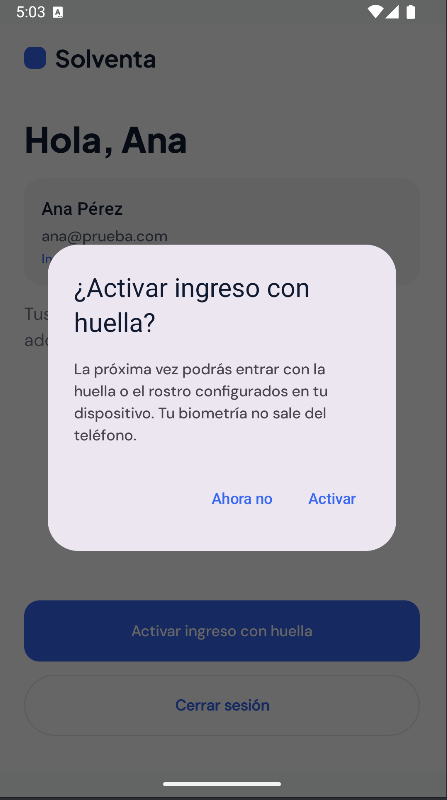
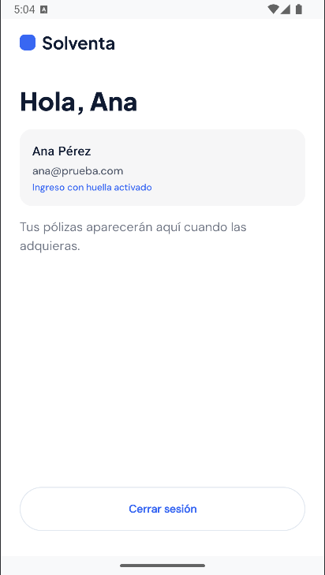
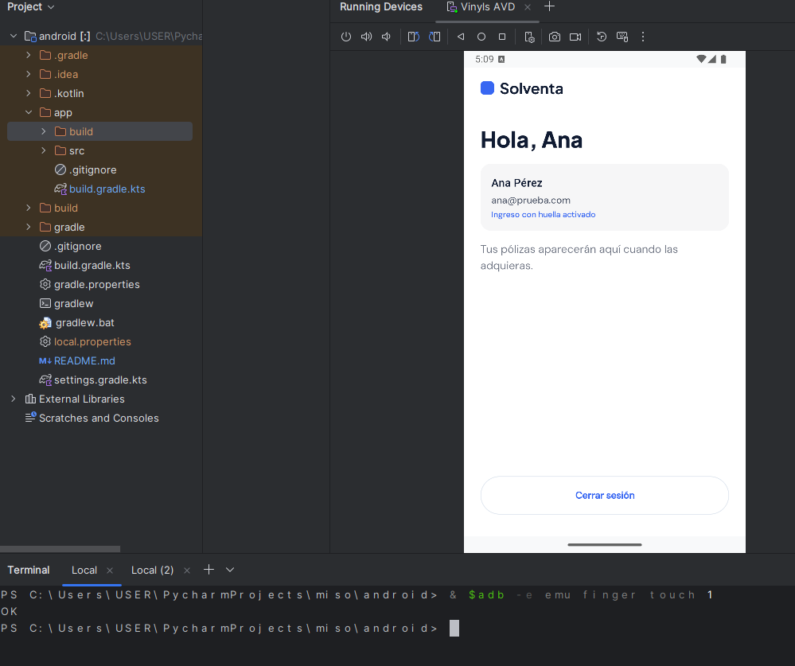
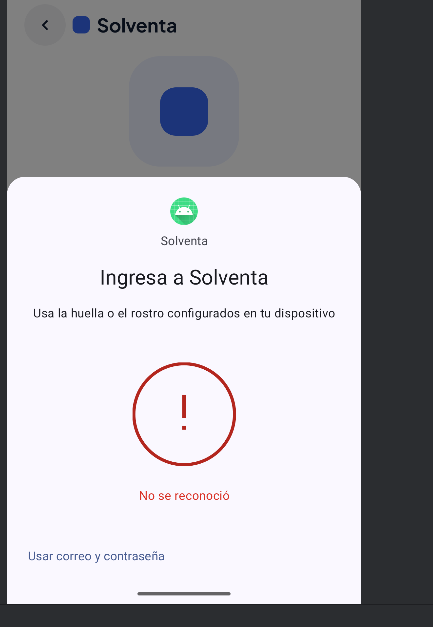

# Evidencias de la HU02 (BPM-23): inicio de sesión biométrico

Pruebas manuales en el emulador de Android Studio (API 35, huella simulada con `adb emu finger touch`), contra el backend local. Fecha: 12 de octubre de 2026.

| # | Caso | Qué demuestra |
|---|---|---|
| 1 | Pantalla de bienvenida | Antes de autenticar no se muestra ningún dato del cliente. |
| 2 | Ingreso biométrico disponible | La app detecta la huella del dispositivo y habilita el botón (BPM-110). |
| 3 | Huella aún no activada | Sin sesión guardada, la app lleva al ingreso con correo y contraseña (BPM-114). |
| 4 | Ingreso con credenciales | El login contra el backend abre la sesión y carga el perfil desde /auth/me. |
| 5 | Oferta de activación | Tras entrar con credenciales, la app ofrece activar la huella. |
| 6 | Huella activada | El refresh token queda cifrado en el Android Keystore (BPM-112). |
| 7 | Ingreso solo con huella | Tras reabrir la app, la huella (finger touch 1) abre la sesión sin contraseña: rota el refresh token en el backend (BPM-111, BPM-113). |
| 8 | Huella no reconocida | Con una huella no registrada (finger touch 2) se rechaza el acceso y se permite reintentar o usar credenciales (BPM-117, BPM-118). |

### 1. Pantalla de bienvenida

Antes de autenticar no se muestra ningún dato del cliente.

### 2. Ingreso biométrico disponible

La app detecta la huella del dispositivo y habilita el botón (BPM-110).

### 3. Huella aún no activada

Sin sesión guardada, la app lleva al ingreso con correo y contraseña (BPM-114).

### 4. Ingreso con credenciales

El login contra el backend abre la sesión y carga el perfil desde /auth/me.

### 5. Oferta de activación

Tras entrar con credenciales, la app ofrece activar la huella.

### 6. Huella activada

El refresh token queda cifrado en el Android Keystore (BPM-112).

### 7. Ingreso solo con huella

Tras reabrir la app, la huella (finger touch 1) abre la sesión sin contraseña: rota el refresh token en el backend (BPM-111, BPM-113).

### 8. Huella no reconocida

Con una huella no registrada (finger touch 2) se rechaza el acceso y se permite reintentar o usar credenciales (BPM-117, BPM-118).

