# Evidencias de la HU04 (BPM-27) y el EC10 (BPM-84): reporte de siniestro con evidencias

Prueba manual en la app Android (emulador) y en la API (Postman) contra el backend local, con la clienta `ana.prueba@gmail.com` y su póliza de viaje vigente SOL-VJ-651881B5-01. Fecha: 10 de noviembre de 2026.

El siniestro de la prueba quedó registrado como `SIN-4b1ecc05-64dd-4415-8c01-3213024a27a5`, de tipo **Robo o hurto**, con 4 evidencias: 2 fotos y 1 video con ubicación, y 1 foto de la galería sin ubicación.

| # | Caso | Qué demuestra |
|---|---|---|
| 1 | Permiso de ubicación | Al abrir el reporte, la app pide una vez el permiso de ubicación. |
| 2 | Tipo de siniestro | El formulario pide el tipo de siniestro entre ocho opciones. |
| 3 | Tipo obligatorio | Sin tipo de siniestro, el reporte no se envía. |
| 4 | Cámara | La foto se toma con la cámara del dispositivo. |
| 5 | Fotos con ubicación | Cada foto queda pendiente de envío, con su tamaño y con ubicación. |
| 6 | Video | El video también se adjunta con ubicación. |
| 7 | Galería sin ubicación | Un archivo de la galería se adjunta y la app avisa que va sin ubicación. |
| 8 | Sin conexión | En modo avión el reporte queda guardado como borrador con todos sus datos. |
| 9 | Nada se envió sin conexión | Mientras no hay red, la lista sigue con los 2 siniestros anteriores. |
| 10 | Envío al recuperar la señal | Con conexión, el borrador se envía y aparece un solo siniestro nuevo. |
| 11 | Sin permiso de ubicación | Si el cliente niega la ubicación, la evidencia se adjunta y la app avisa que irá sin geoetiqueta. |
| 12 | Evidencias en la API | El backend guardó las 4 evidencias con su huella SHA-256, fecha de captura y ubicación. |
| 13 | Archivo alterado | Se modifica un archivo almacenado y la descarga responde 409 `EVIDENCIA_ALTERADA`. |
| 14 | Cliente sin acceso a la bitácora | La clienta no puede consultar la bitácora de auditoría (403). |
| 15 | Bitácora de auditoría | Operaciones consulta la bitácora: cada carga, consulta y falla de integridad tiene autor, rol, IP y fecha. |
| 16 | Pruebas automatizadas | Backend y Android en verde. |

## App Android (HU04)

### 1. Permiso de ubicación

Al abrir el reporte, la app pide una vez el permiso de ubicación. Se concedió **Mientras la app está en uso**.

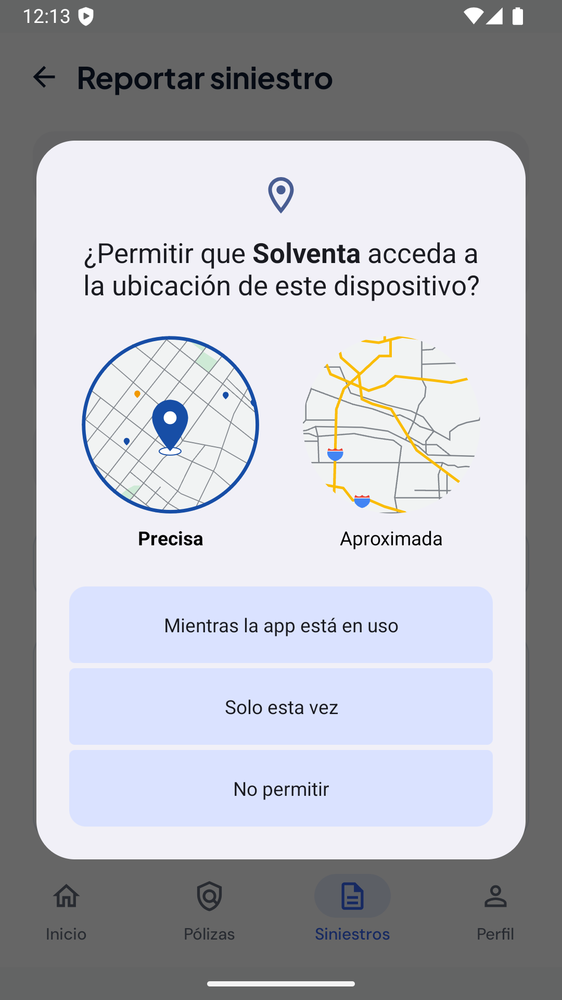

### 2. Tipo de siniestro

El formulario pide el tipo de siniestro: daño material, robo o hurto, accidente, enfermedad, fallecimiento, incidente de viaje, evento climático u otro.

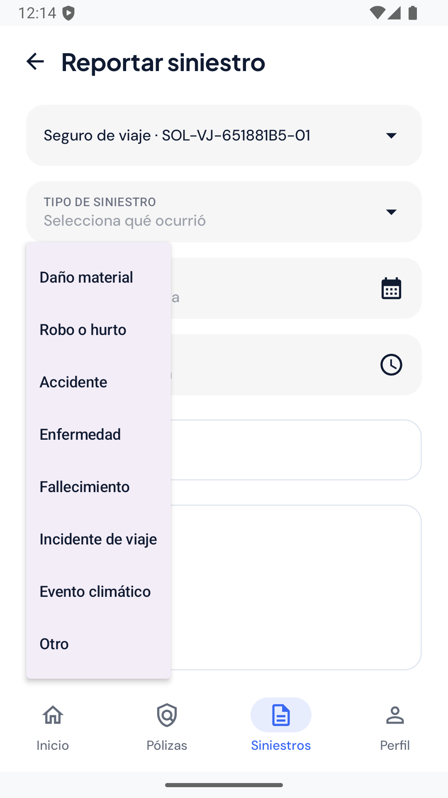

### 3. Tipo obligatorio

Con la fecha, la hora, el lugar y la descripción diligenciados pero sin tipo de siniestro, el reporte no se envía y el campo se marca.

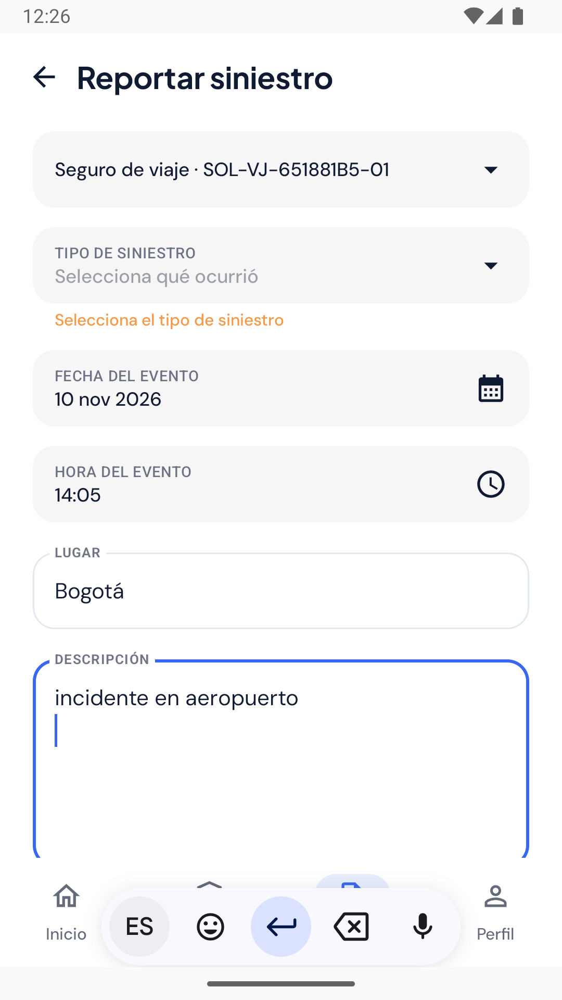

### 4. Cámara

**Foto** abre la cámara del dispositivo. La app no pide el permiso de cámara: usa la app de cámara del sistema, que escribe la foto en la carpeta privada del borrador.


### 5. Fotos con ubicación

Cada foto queda en la lista como pendiente de envío, con su tamaño y con ubicación.

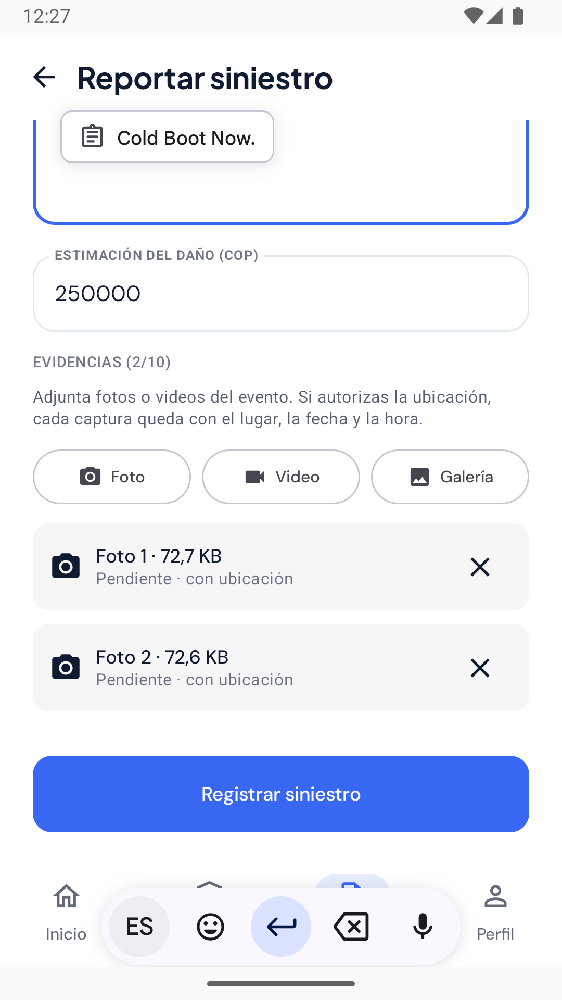

### 6. Video

**Video** graba con la cámara y lo adjunta con ubicación (561 KB).

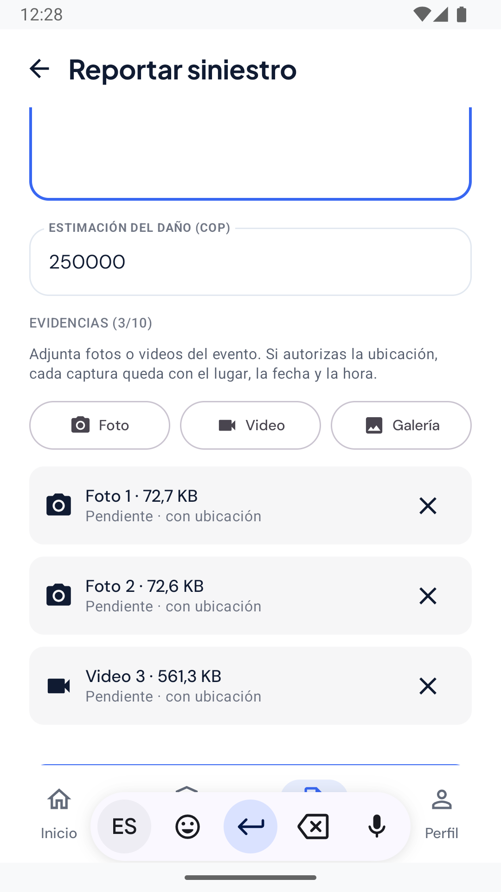

### 7. Galería sin ubicación

Una imagen elegida de la galería se adjunta sin ubicación, porque no se sabe dónde se tomó, y la app lo informa.

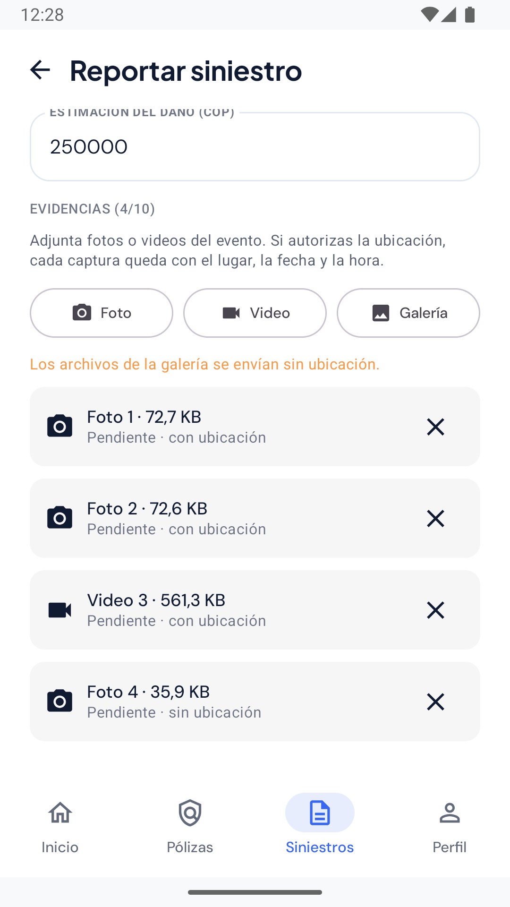

### 8. Sin conexión

En modo avión, **Registrar siniestro** guarda el reporte como borrador con la póliza, el tipo, la fecha, la hora, el lugar, la descripción y las 4 evidencias.

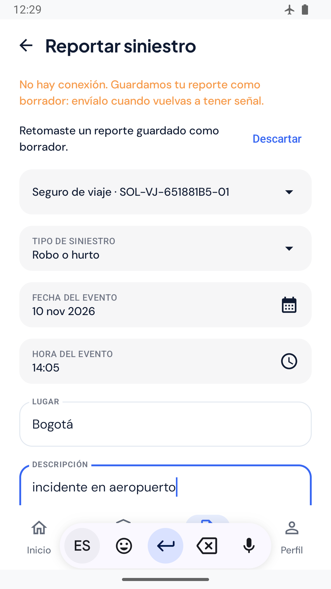

### 9. Nada se envió sin conexión

Sin red, la lista de siniestros no se puede actualizar y sigue mostrando los 2 siniestros anteriores.

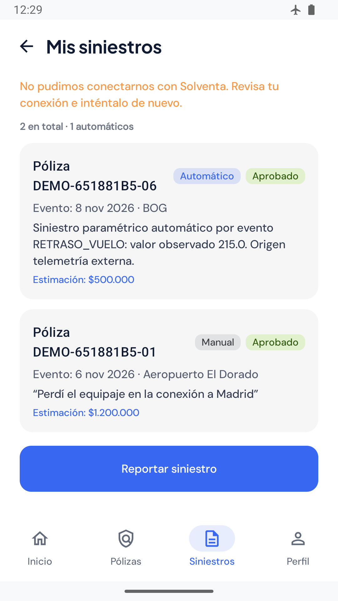

### 10. Envío al recuperar la señal

Con la conexión de vuelta, el borrador se envía: el siniestro de Bogotá por $250.000 aparece como **Registrado**. Hay un solo siniestro nuevo, porque el reintento usa el id del borrador como `Idempotency-Key`.

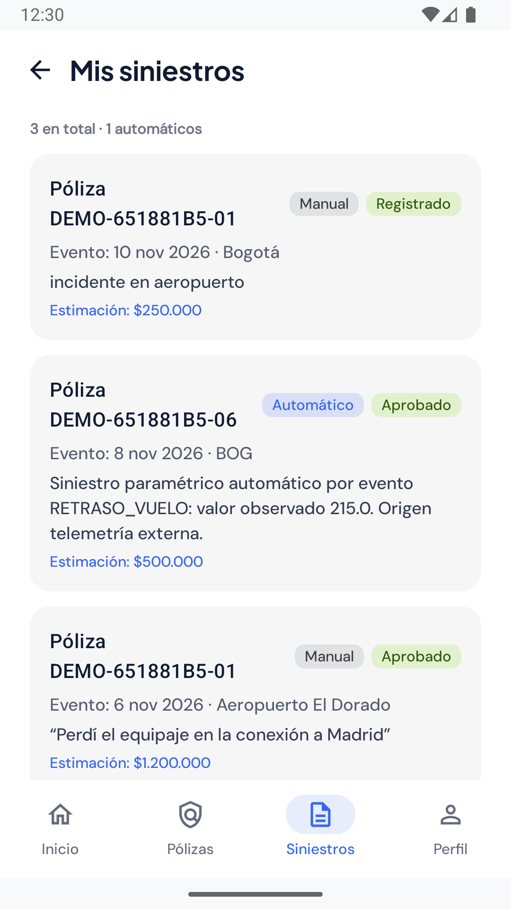

### 11. Sin permiso de ubicación

Con el permiso de ubicación negado en los ajustes, la foto se adjunta igual y la app avisa que irá sin geoetiqueta.

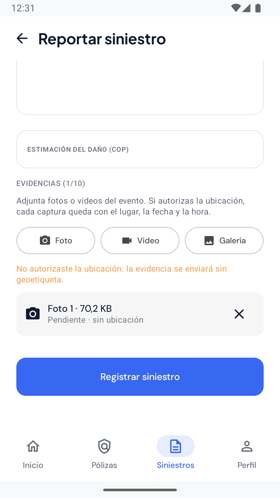

## API, integridad y auditoría (EC10)

### 12. Evidencias en la API

`GET /api/v1/siniestros/SIN-4b1ecc05-64dd-4415-8c01-3213024a27a5/evidencias` con el token de la clienta. El backend calculó la huella de cada archivo y guardó la fecha de captura y la ubicación. La ubicación es la predeterminada del emulador. Extracto:

```json
[
  {
    "evidencia_id": "EVI-7bda630c-ec67-4346-8775-9aa98b947944",
    "tipo": "FOTO",
    "tipo_contenido": "image/jpeg",
    "tamano_bytes": 74405,
    "huella_sha256": "623efe16ebe94ecf2ff357de5e86f4f4ba28b6238cda827d01025a785eea84fd",
    "capturada_en": "2026-11-11T00:27:24Z",
    "latitud": 37.4219983,
    "longitud": -122.084,
    "precision_metros": 5.0,
    "geoetiquetada": true
  },
  {
    "evidencia_id": "EVI-c2b3beb1-bbc0-4d80-ad68-f88930caa425",
    "tipo": "VIDEO",
    "tipo_contenido": "video/mp4",
    "tamano_bytes": 574723,
    "huella_sha256": "566fd82c1cf3e0d918c99cf6b4a37b02a3bf4f2fb8022c62c53bfdeed55087bc",
    "geoetiquetada": true
  },
  {
    "evidencia_id": "EVI-bc410205-0887-4171-9fe1-c6bccaf8c1be",
    "tipo": "FOTO",
    "tamano_bytes": 36771,
    "huella_sha256": "4d912336d4c08c45cf41d50f486306ccd1ac0f78c435990aa932ecb50bc31871",
    "capturada_en": null,
    "latitud": null,
    "longitud": null,
    "geoetiquetada": false
  }
]
```

### 13. Archivo alterado

Se agregó texto al final del archivo de la foto de la galería, directamente en el almacén:

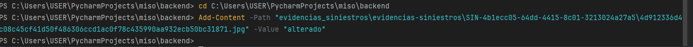

Al descargarla como Operaciones (`GET …/evidencias/EVI-bc410205-0887-4171-9fe1-c6bccaf8c1be/contenido`), el backend recalcula la huella, no coincide con la registrada y responde **409 `EVIDENCIA_ALTERADA`** sin entregar el archivo.

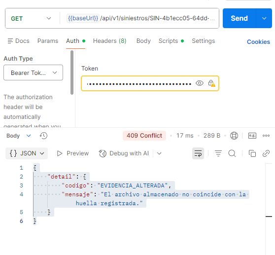

### 14. Cliente sin acceso a la bitácora

La clienta consulta `GET …/evidencias/auditoria` y recibe **403 `ACCESS_DENIED`**: solo Operaciones/Siniestros y el analista de cumplimiento ven la bitácora.

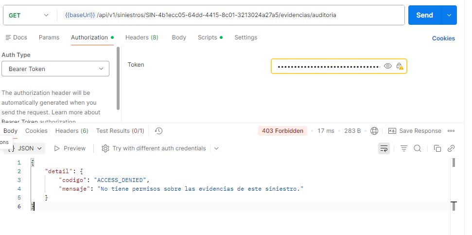

### 15. Bitácora de auditoría

Operaciones consulta `GET …/evidencias/auditoria` (200). Las 4 cargas vienen de la app (`okhttp`) y la consulta y la falla de integridad, de Postman. Cada registro tiene el autor, su rol, la IP y la fecha. Extracto, con los identificadores y las huellas recortados:

```json
[
  {"evidencia_id": "EVI-7bda630c-…", "accion": "CARGA", "rol": "CLIENTE", "ip": "127.0.0.1", "user_agent": "okhttp/4.12.0",
   "detalle": "FOTO;74405 bytes;sha256:623efe16…", "ocurrido_en": "2026-11-11T00:30:27.699154Z"},
  {"evidencia_id": "EVI-372a317f-…", "accion": "CARGA", "rol": "CLIENTE", "ip": "127.0.0.1", "user_agent": "okhttp/4.12.0",
   "detalle": "FOTO;74375 bytes;sha256:ee74fea1…", "ocurrido_en": "2026-11-11T00:30:27.786556Z"},
  {"evidencia_id": "EVI-c2b3beb1-…", "accion": "CARGA", "rol": "CLIENTE", "ip": "127.0.0.1", "user_agent": "okhttp/4.12.0",
   "detalle": "VIDEO;574723 bytes;sha256:566fd82c…", "ocurrido_en": "2026-11-11T00:30:27.974679Z"},
  {"evidencia_id": "EVI-bc410205-…", "accion": "CARGA", "rol": "CLIENTE", "ip": "127.0.0.1", "user_agent": "okhttp/4.12.0",
   "detalle": "FOTO;36771 bytes;sha256:4d912336…;sin ubicación", "ocurrido_en": "2026-11-11T00:30:28.057859Z"},
  {"evidencia_id": null, "accion": "CONSULTA", "rol": "CLIENTE", "ip": "127.0.0.1", "user_agent": "PostmanRuntime/7.51.1",
   "detalle": "4 evidencias", "ocurrido_en": "2026-11-11T00:36:04.751243Z"},
  {"evidencia_id": "EVI-bc410205-…", "accion": "INTEGRIDAD_FALLIDA", "rol": "CLIENTE", "ip": "127.0.0.1", "user_agent": "PostmanRuntime/7.51.1",
   "detalle": "la huella del archivo no coincide", "ocurrido_en": "2026-11-11T00:38:34.272316Z"}
]
```

La propia consulta de la bitácora y la descarga del paso 13 por Operaciones también quedaron registradas, como `CONSULTA_AUDITORIA` e `INTEGRIDAD_FALLIDA` con rol `OPERACIONES_SINIESTROS`.

### 16. Pruebas automatizadas

| Componente | Comando | Resultado |
|---|---|---|
| Backend | `pytest tests/siniestros` | 150 pruebas, 0 fallos; `ruff check` y `ruff format --check` limpios |
| Android | `./gradlew lint testDebugUnitTest` | 402 pruebas, 0 fallos, incluidas `SiniestrosEvidenciasTest` (24), `RemoteSiniestrosGatewayTest` (14), `BorradoresSiniestroArchivoTest` (8) y `SiniestroFormValidationTest` (10); lint sin errores |

La documentación técnica está en [Reporte de siniestro con evidencias](../../siniestros-evidencias.md).
