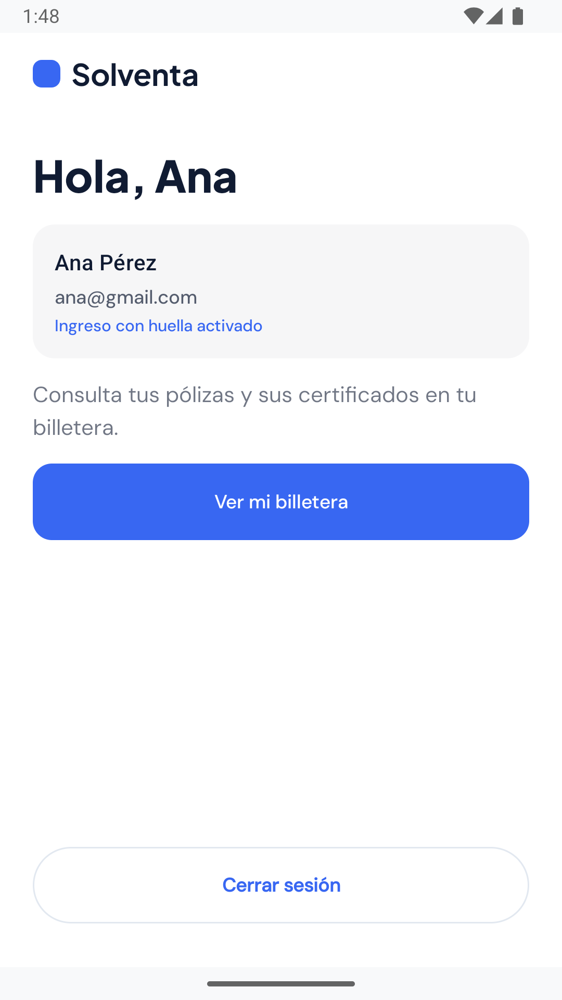
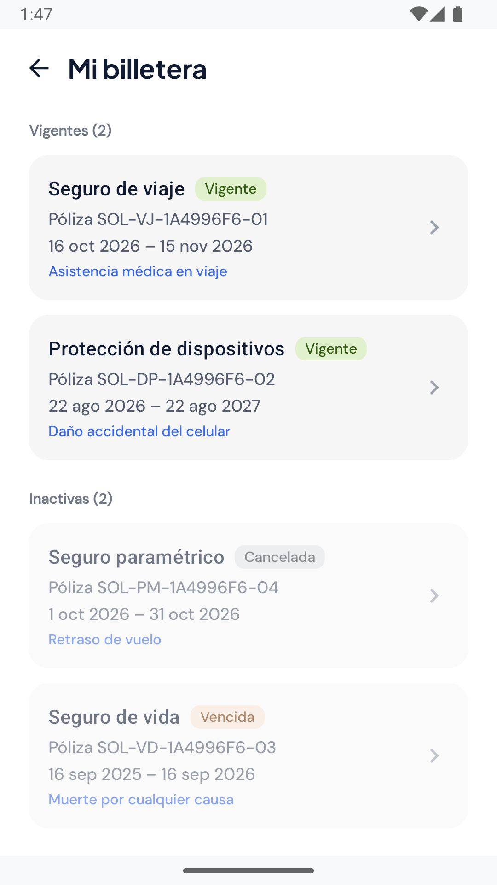
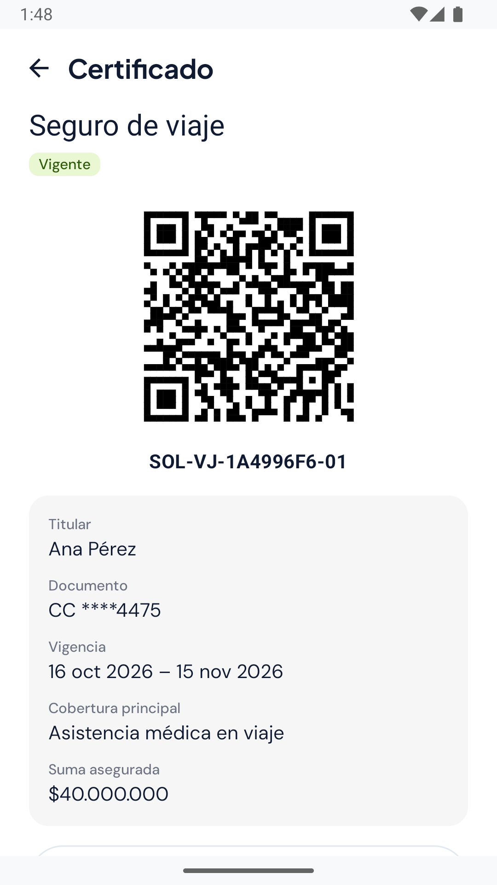
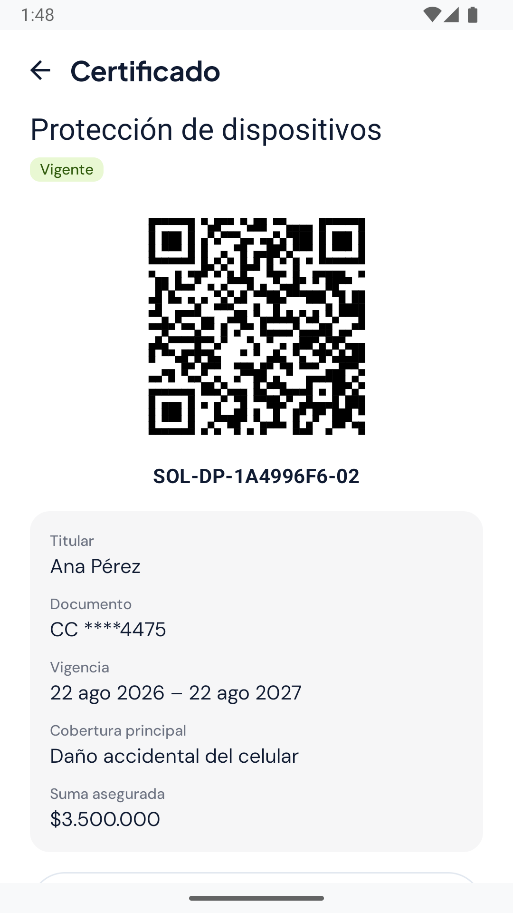
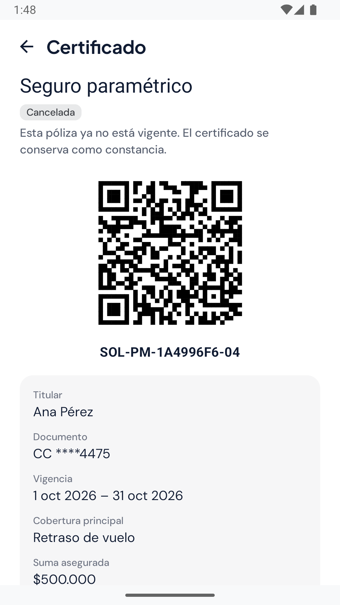
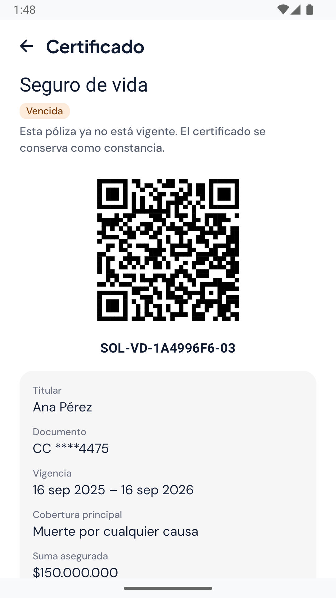

# Evidencias de la HU07 (BPM-31): billetera digital de pólizas

Pruebas manuales en el emulador de Android Studio contra el backend local (SQLite), con el cliente `ana@gmail.com` y las pólizas creadas por `backend/sembrar_polizas.py`. Fecha: 21 de octubre de 2026.

| # | Caso | Qué demuestra |
|---|---|---|
| 1 | Inicio con acceso a la billetera | Con la sesión abierta (ingreso con huella activado), el inicio ofrece **Ver mi billetera**. |
| 2 | Billetera | Lista las pólizas del cliente con número, ramo, estado, vigencia y cobertura. Separa vigentes (2) de inactivas (2). |
| 3 | Certificado vigente (viaje) | Certificado con QR, número de póliza, titular, documento enmascarado, vigencia, cobertura y suma asegurada. |
| 4 | Certificado vigente (dispositivos) | Cada póliza tiene su propio QR y datos. |
| 5 | Certificado cancelado | La póliza cancelada se identifica como inactiva y el certificado se conserva como constancia. |
| 6 | Certificado vencido | La póliza cuya vigencia terminó se marca como vencida, aunque en la base siga registrada como vigente: el vencimiento se calcula con la fecha. |

### 1. Inicio con acceso a la billetera

Con la sesión abierta, el inicio ofrece **Ver mi billetera**.

### 2. Billetera

Lista las pólizas del cliente con número, ramo, estado, vigencia y cobertura. Las vigentes van primero; las canceladas y vencidas, en "Inactivas".

### 3. Certificado vigente (viaje)

Certificado con QR, número de póliza, titular, documento enmascarado (`CC ****4475`), vigencia, cobertura y suma asegurada.

### 4. Certificado vigente (dispositivos)

Cada póliza tiene su propio QR y sus datos.

### 5. Certificado cancelado

La póliza cancelada se identifica como inactiva y el certificado se conserva como constancia.

### 6. Certificado vencido

La vigencia terminó el 16 de septiembre de 2026, así que la póliza aparece como vencida.

