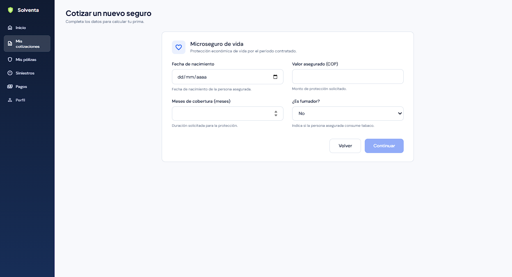
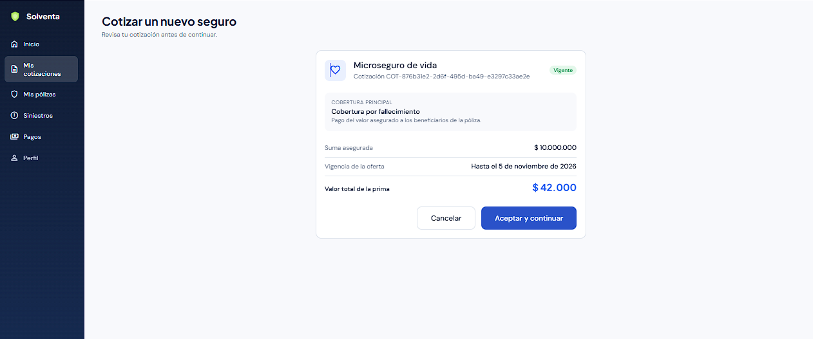
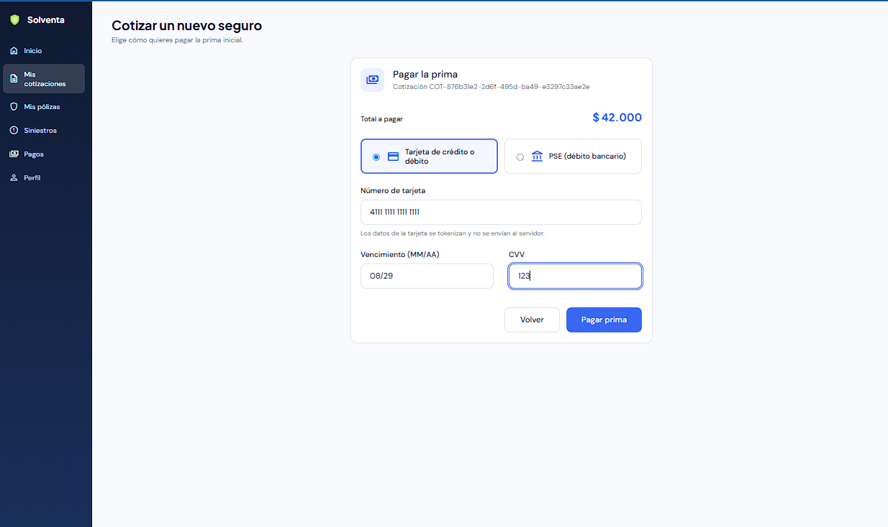
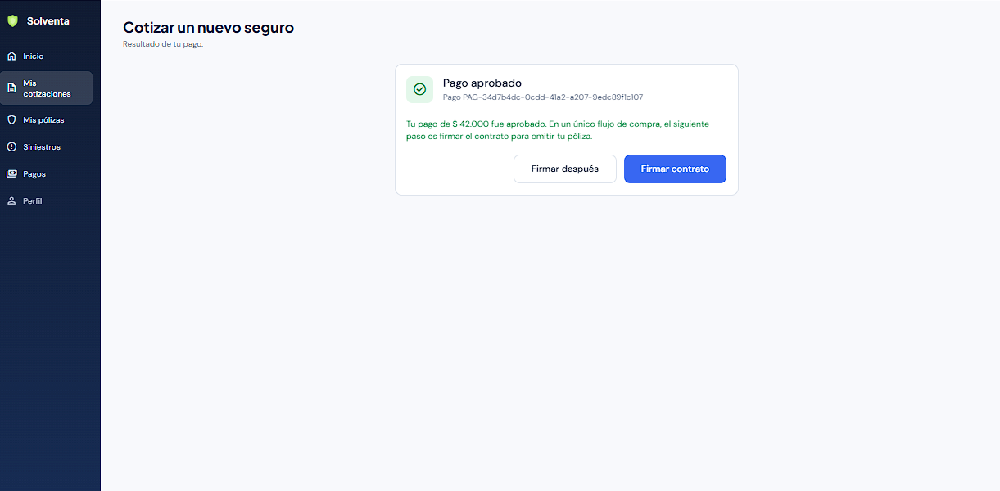
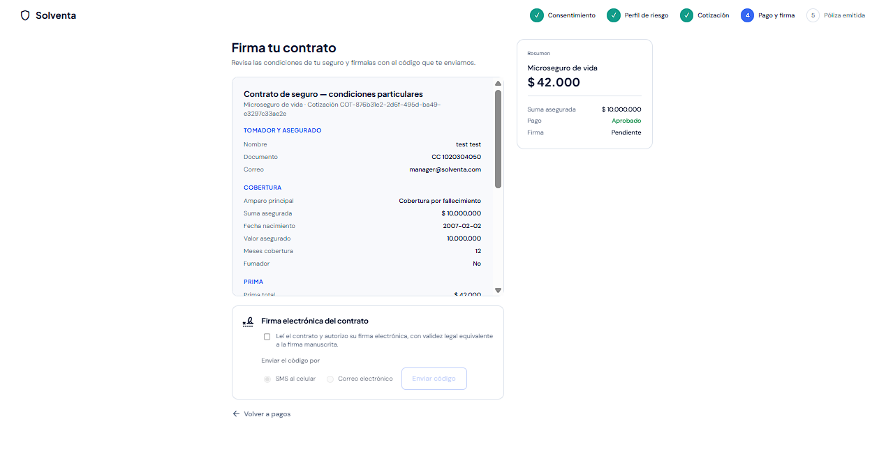
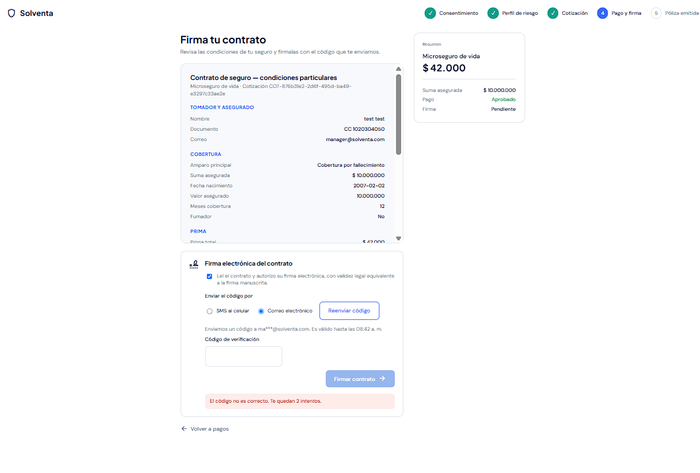
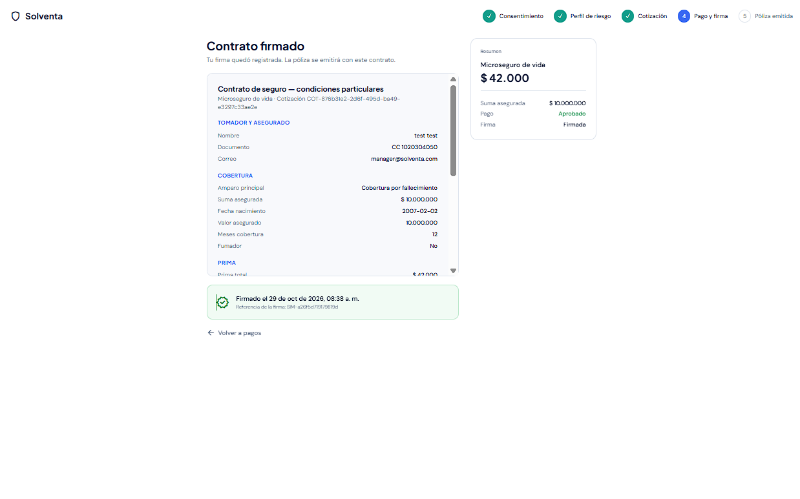
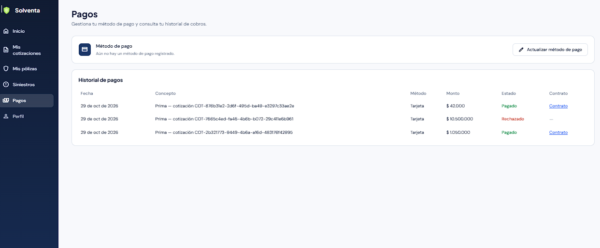
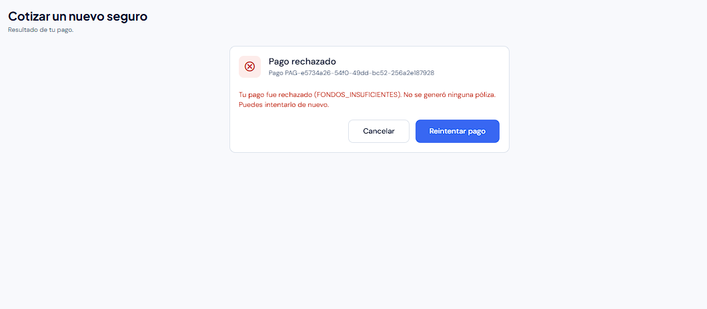
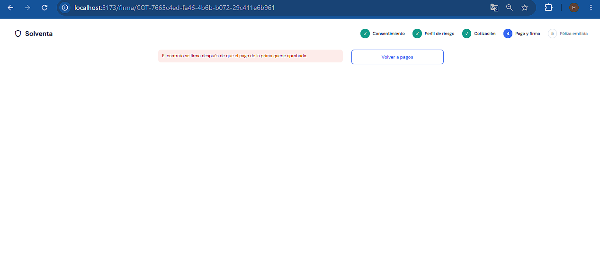

# Evidencias de la HU14 (BPM-60): firma electrónica del contrato

Pruebas manuales en el portal web (Chrome en Windows) contra el backend local (SQLite), con un cliente registrado por el flujo de HU19 y el proveedor de firma simulado. La compra se hizo por el flujo web de HU23 con un Microseguro de vida. Fecha: 29 de octubre de 2026.

| # | Caso | Qué demuestra |
|---|---|---|
| 1–3 | Cotizar y pagar | Cotización de un Microseguro de vida y pago de la prima con tarjeta (HU03, HU13, HU23) |
| 4 | Pago aprobado | Tras el recaudo exitoso, la compra ofrece **Firmar contrato** |
| 5 | Contrato prellenado | Condiciones particulares con titular, cobertura, datos del riesgo, prima y cláusulas |
| 6 | Código incorrecto | El código OTP llega por correo, vence en 5 minutos y un código errado descuenta intentos |
| 7 | Contrato firmado | Firma con el código correcto: fecha y referencia del sello del proveedor |
| 8 | Acceso desde Pagos | Cada pago aprobado abre su contrato |
| 9–10 | Sin pago aprobado | Con el pago rechazado no se presenta ni se firma el contrato |
| — | Registro de la firma | Metadatos guardados e integridad del documento verificada |

### 1–3. Cotizar y pagar la prima

### 4. Pago aprobado

El siguiente paso de la compra es la firma del contrato.

### 5. Contrato prellenado

El contrato se arma con los datos del titular, la cobertura y los datos del riesgo de la cotización, la prima efectivamente pagada y las cláusulas del ramo. El nombre del ramo es el del catálogo de cotización. El resumen confirma que el pago está aprobado y la firma pendiente. La firma exige marcar la autorización antes de pedir el código.

### 6. Código incorrecto

El código se envió al correo enmascarado (`ma***@solventa.com`) con vencimiento a los 5 minutos. Con un código errado la firma se rechaza y quedan 2 intentos. El reenvío espera 30 segundos.

### 7. Contrato firmado

Con el código correcto el contrato queda firmado. Se muestran la fecha y la referencia de la firma, y el resumen pasa a **Firmada**.

### 8. Acceso desde Pagos

El historial ofrece **Contrato** solo en los pagos aprobados. El pago rechazado no tiene contrato.

### 9–10. Sin pago aprobado

Con una tarjeta rechazada (`FONDOS_INSUFICIENTES`), al abrir `/firma/{cotizacion}` el backend responde `PAGO_NO_APROBADO` y no se presenta el contrato.

### Registro de la firma

Fila de `firmas_contrato` para la cotización `COT-876b31e2…` después de firmar:

| Campo | Valor |
|---|---|
| `estado` | `FIRMADA` |
| `firmado_en` | 2026-10-29 13:38:57 UTC (08:38 hora de Colombia) |
| `firmante_id` | Id del cliente autenticado |
| `ip_firmante` | `127.0.0.1` (ambiente local) |
| `user_agent` | Chrome 156 en Windows 10 |
| `huella_documento` | `8e55a63f68cde0bad33b71bdb8da166124b61893f5cbb19ae92cda74c05d94e1` |
| `referencia_proveedor` | `SIM-a26f5d719179819d` |
| `sello_proveedor` | `e7a29d510d0fdf25deb87dd1815e1264d3e62c0ef284ed41322b7256261c2400` |
| `otp_hash` | Vacío: el código se borra al firmar y nunca se guardó en claro |
| `otp_canal` / `otp_destino` | `EMAIL` / `ma***@solventa.com` |
| `envios` / `intentos_fallidos` | 1 / 1 |
| `version_plantilla` | `2026.10.2` |

Al recalcular el SHA-256 de la forma canónica del contrato guardado se obtiene la misma `huella_documento`: el documento firmado es el que se presentó (EC10).
