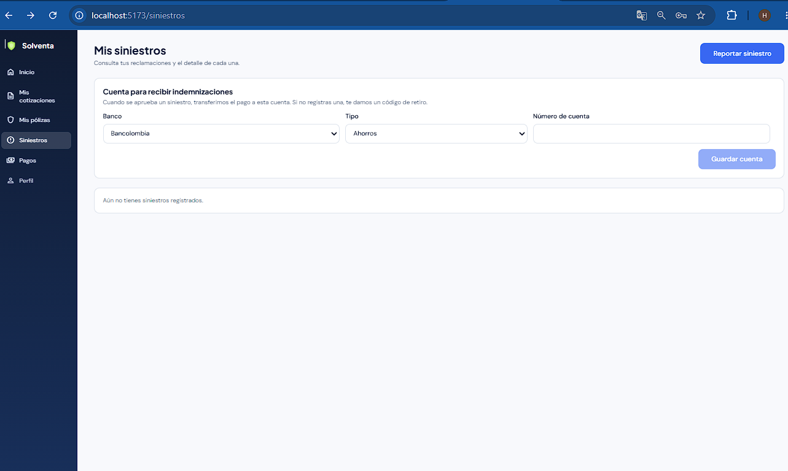
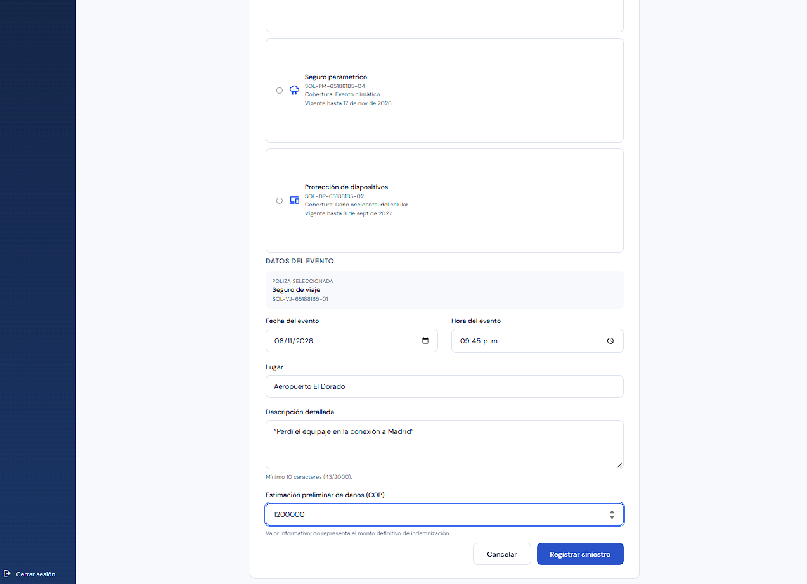
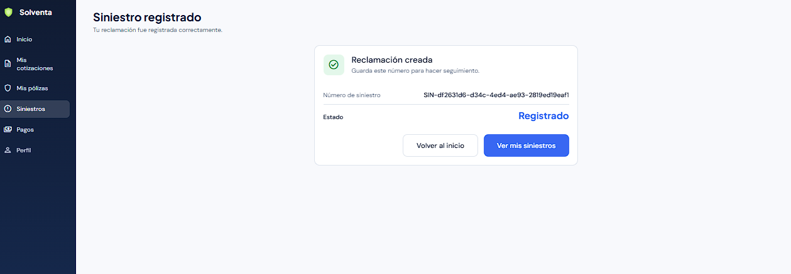
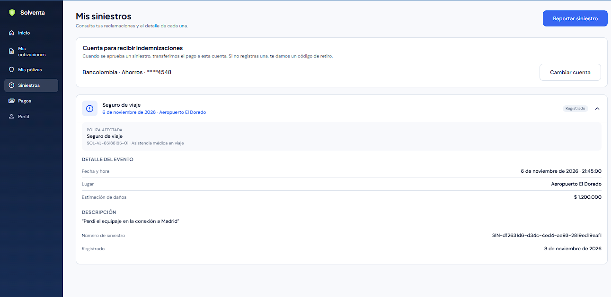
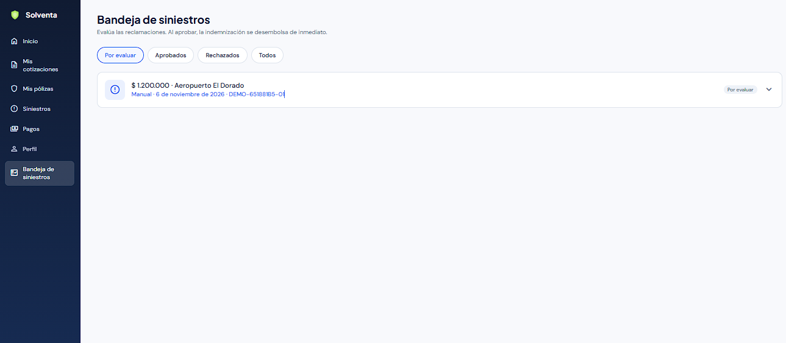
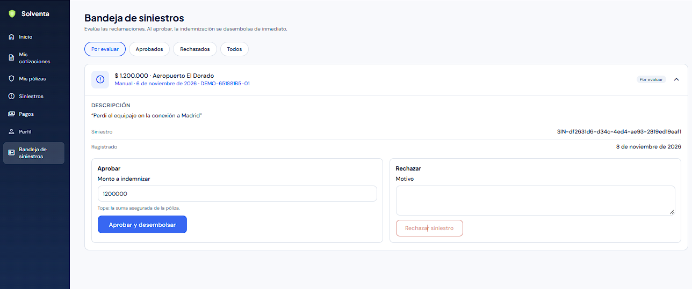
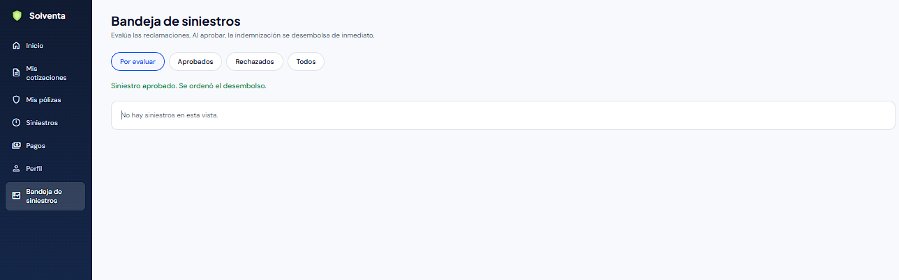
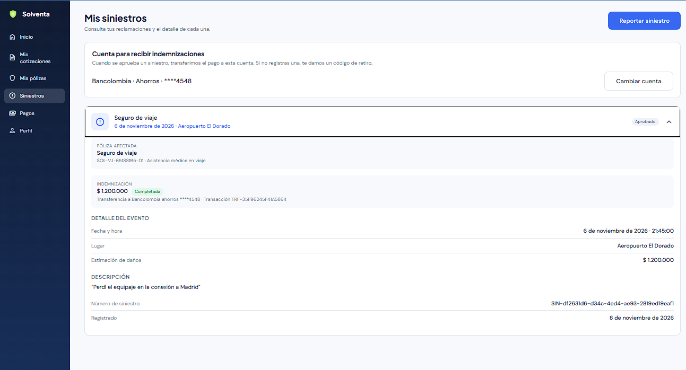
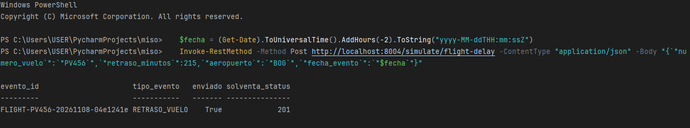
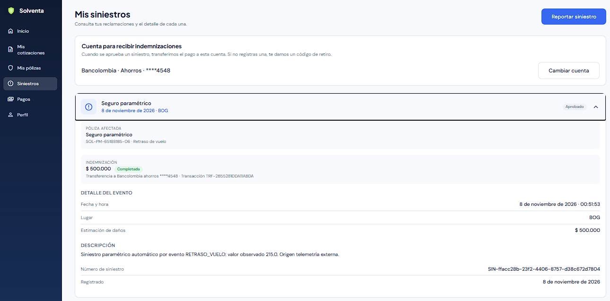

# Evidencias de la HU15 (BPM-65): desembolso automatizado e idempotente de indemnizaciones

Pruebas manuales en el portal web (Chrome en Windows) contra el backend local (SQLite), con la red de desembolsos simulada y el proveedor de telemetría simulado. El cliente se registró por el flujo de HU19 y sus pólizas se sembraron con `sembrar_polizas.py`. El usuario de Operaciones/Siniestros se creó con `crear_admin.py`. Fecha: 7 de noviembre de 2026.

| # | Caso | Qué demuestra |
|---|---|---|
| 1 | Cuenta sin registrar | El cliente ve dónde registrar la cuenta para recibir indemnizaciones; sin ella se le emite un código de retiro |
| 2–3 | Reporte del siniestro | Siniestro manual sobre el seguro de viaje: queda **Registrado** |
| 4 | Cuenta registrada | La cuenta se guarda tokenizada: solo se muestran banco, tipo y `****4548` |
| 5–6 | Bandeja de Operaciones | El siniestro aparece «Por evaluar» con el monto prellenado y las opciones de aprobar o rechazar con motivo |
| 7 | Aprobación | Al aprobar se ordena el desembolso de inmediato y el siniestro sale de «Por evaluar» |
| 8 | Indemnización del cliente | Siniestro **Aprobado**, $ 1.200.000 **Completada**, cuenta destino e ID de la transacción (`TRF-…`) |
| 9–10 | Paramétrico | Un retraso del vuelo PV456 crea el siniestro, se aprueba solo y se pagan $ 500.000 sin intervención de Operaciones |

### 1. Cuenta sin registrar

### 2–3. Reporte del siniestro

### 4. Cuenta registrada

El número completo no se guarda: la red de desembolsos lo tokeniza y Solventa conserva el token y los últimos 4 dígitos.

### 5–6. Bandeja de siniestros (Operaciones/Siniestros)

El monto viene prellenado con la estimación y tiene como tope la suma asegurada de la póliza.

### 7. Siniestro aprobado

### 8. Indemnización vista por el cliente

### 9–10. Siniestro paramétrico pagado automáticamente

El proveedor de telemetría empuja el evento (Solventa responde `201`) y el siniestro queda aprobado por `SISTEMA` y pagado.

## Cubierto por pruebas automatizadas

Los casos de fallo y reintento (cuenta inexistente → `FALLIDA`, red caída → `PENDIENTE` con la misma referencia), la idempotencia ante aprobaciones repetidas o concurrentes, el tope de la suma asegurada y los permisos por rol están cubiertos en `backend/tests/desembolsos` y en las pruebas de la web.
