# Evidencias de la HU16 (BPM-68): modificación de coberturas y endosos

Pruebas manuales en el portal web (Chrome) contra el backend local, con una póliza de vida vigente creada por `sembrar_polizas.py`. Fecha: 4 de noviembre de 2026.

| # | Caso | Qué demuestra |
|---|---|---|
| 1 | Acceso desde Mis pólizas | En el detalle de una póliza vigente aparece el botón Modificar coberturas y beneficiarios. |
| 2 | Formulario de modificación | Coberturas opcionales del ramo con sus límites: la contratada carga su suma con separador de miles y las demás aparecen como no incluidas. Abajo, el historial de endosos. |
| 3 | Porcentajes que suman 120 % | Con dos beneficiarios al 60 %, el total se marca en rojo y no se puede calcular el ajuste. |
| 4 | Porcentajes que suman 90 % | Tampoco se permite calcular si falta porcentaje por asignar. |
| 5 | Porcentajes que suman 100 % | Con 60 % y 40 % el total queda en verde y se habilita el cálculo. |
| 6 | Propuesta de cambio de beneficiarios | El backend resume los cambios: designar beneficiarios no cambia la prima. |
| 7 | Aceptación expresa | El endoso solo se emite después de que el cliente acepta los cambios y el ajuste. |
| 8 | Propuesta con cobertura opcional | Incluir incapacidad total y permanente por $50.000.000 genera un cobro de $49.200 por 246 de 366 días de vigencia; la nueva prima es $199.200. |
| 9 | Endoso emitido | Tras confirmar, el endoso No. 2 rige sobre la póliza y su PDF se descarga de inmediato. |
| 10 | Documento del endoso | Anexo con los cambios, las coberturas vigentes, los beneficiarios, el ajuste de prima y la huella de la solicitud. El PDF original de la póliza no se modifica. |
| 11 | Póliza de otro ramo | En un seguro de viaje se ofrecen sus propias coberturas opcionales y no aparece la sección de beneficiarios. |

### 1. Acceso desde Mis pólizas

En el detalle de una póliza vigente aparece el botón Modificar coberturas y beneficiarios.

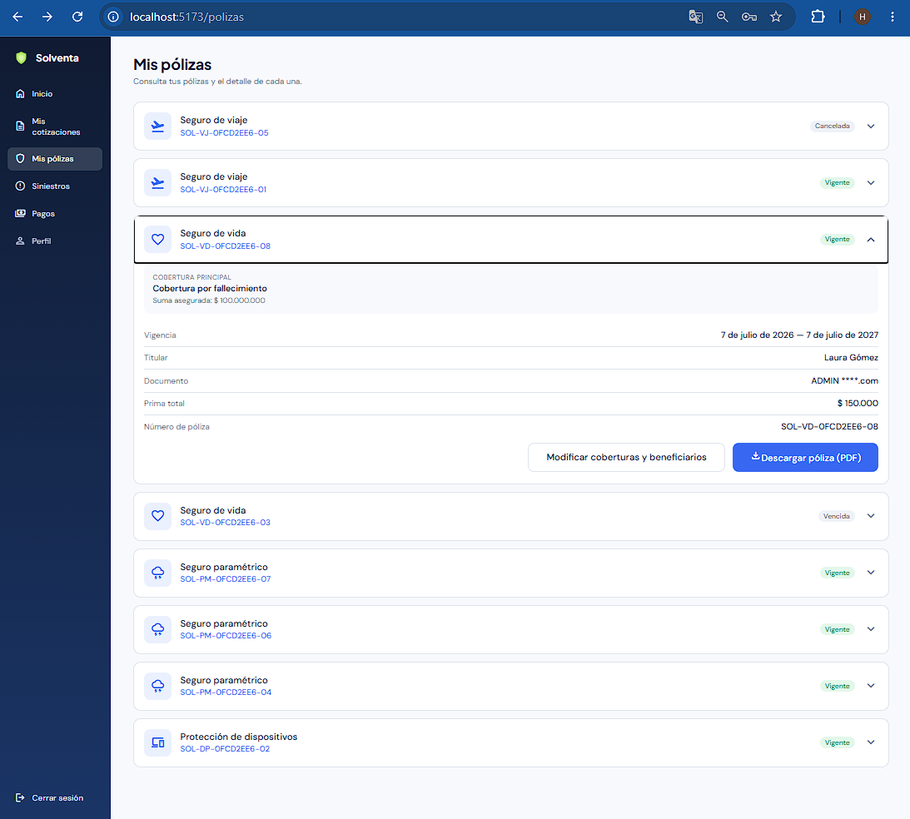

### 2. Formulario de modificación

Coberturas opcionales del ramo con sus límites: la contratada carga su suma con separador de miles y las demás aparecen como no incluidas. Abajo, el historial de endosos.

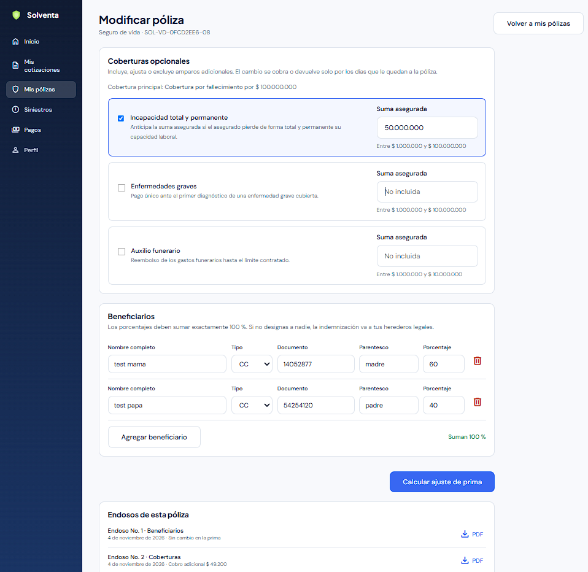

### 3. Porcentajes que suman 120 %

Con dos beneficiarios al 60 %, el total se marca en rojo y no se puede calcular el ajuste.

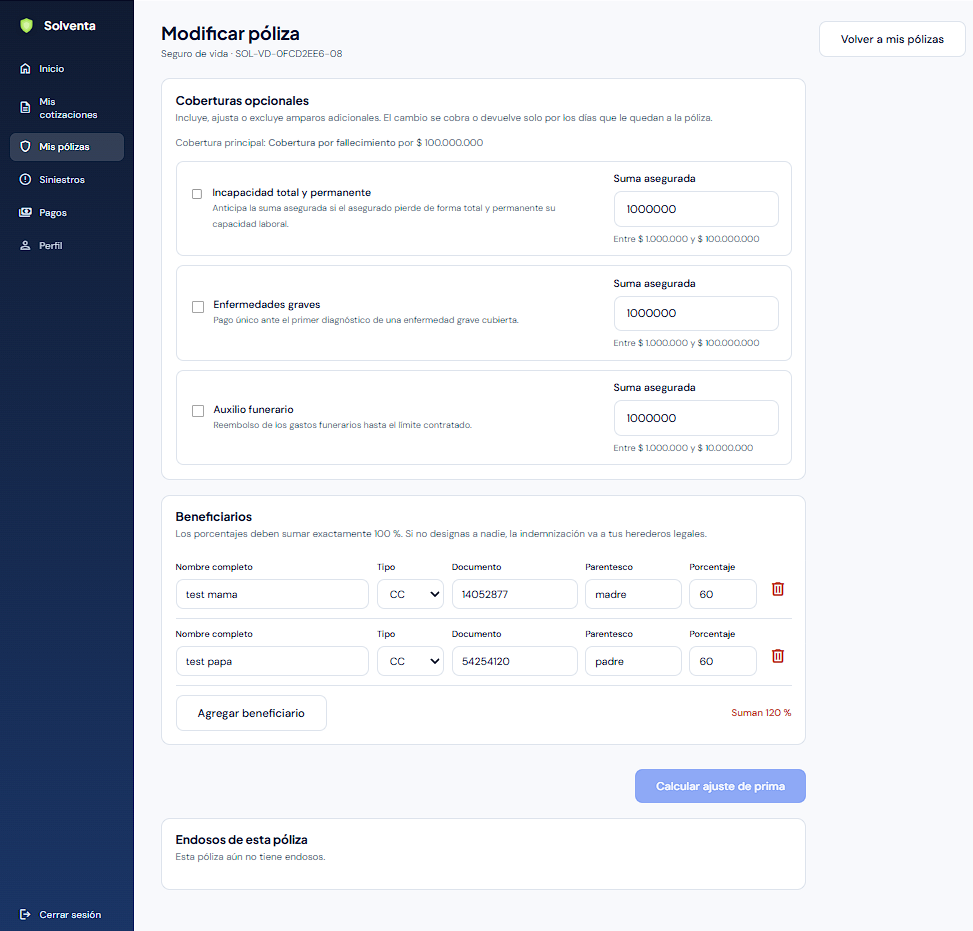

### 4. Porcentajes que suman 90 %

Tampoco se permite calcular si falta porcentaje por asignar.

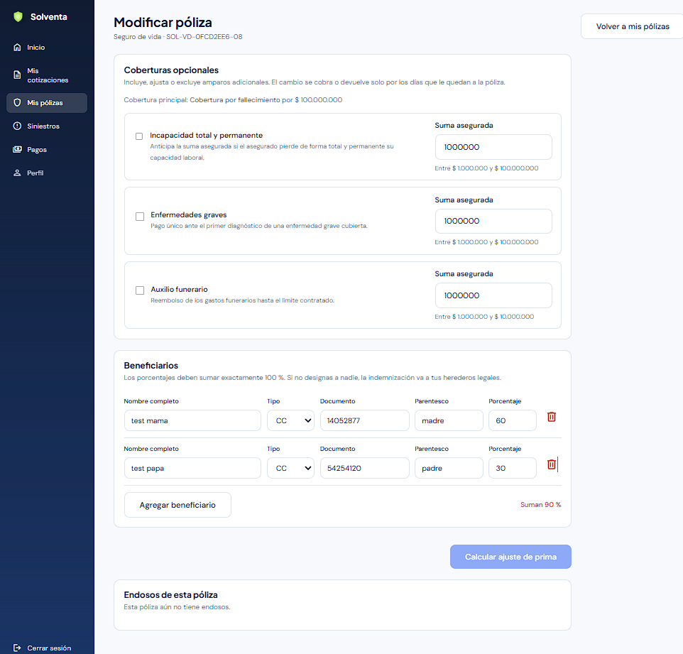

### 5. Porcentajes que suman 100 %

Con 60 % y 40 % el total queda en verde y se habilita el cálculo.

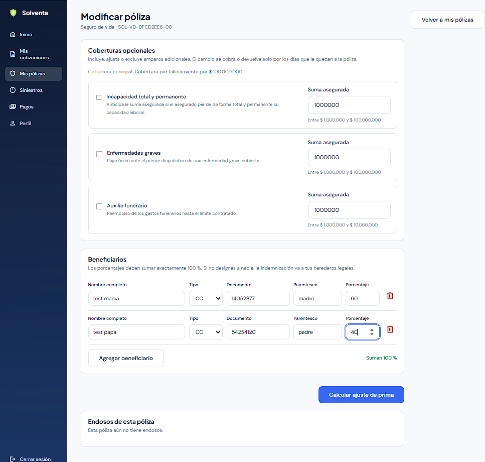

### 6. Propuesta de cambio de beneficiarios

El backend resume los cambios: designar beneficiarios no cambia la prima.

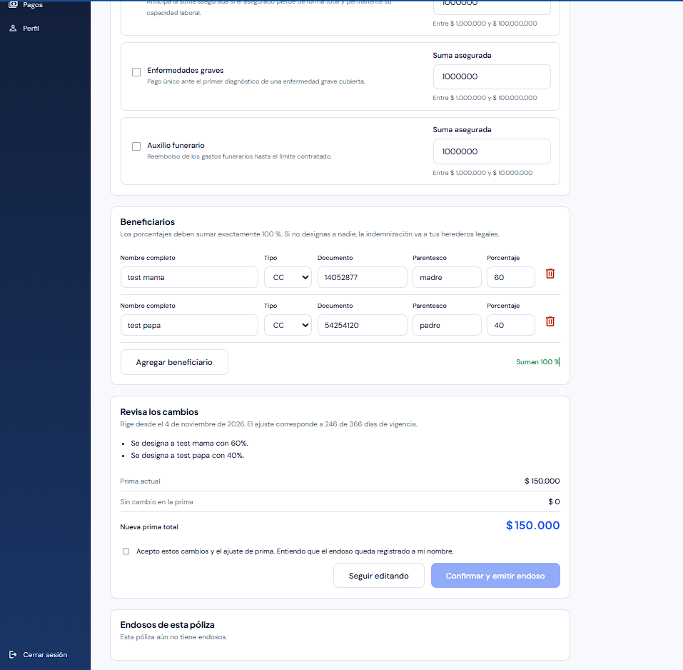

### 7. Aceptación expresa

El endoso solo se emite después de que el cliente acepta los cambios y el ajuste.

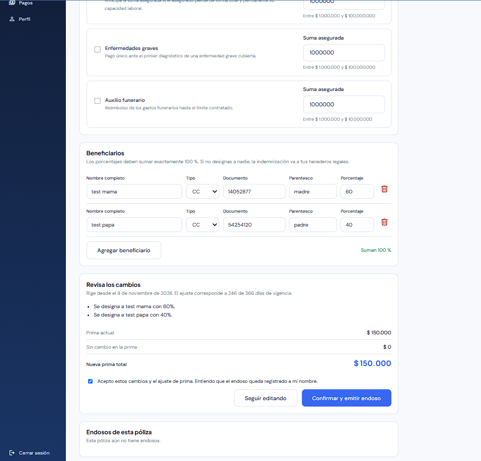

### 8. Propuesta con cobertura opcional

Incluir incapacidad total y permanente por $50.000.000 genera un cobro de $49.200 por 246 de 366 días de vigencia; la nueva prima es $199.200.

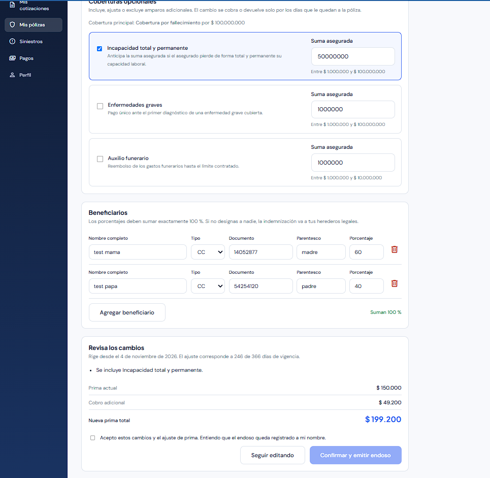

### 9. Endoso emitido

Tras confirmar, el endoso No. 2 rige sobre la póliza y su PDF se descarga de inmediato.

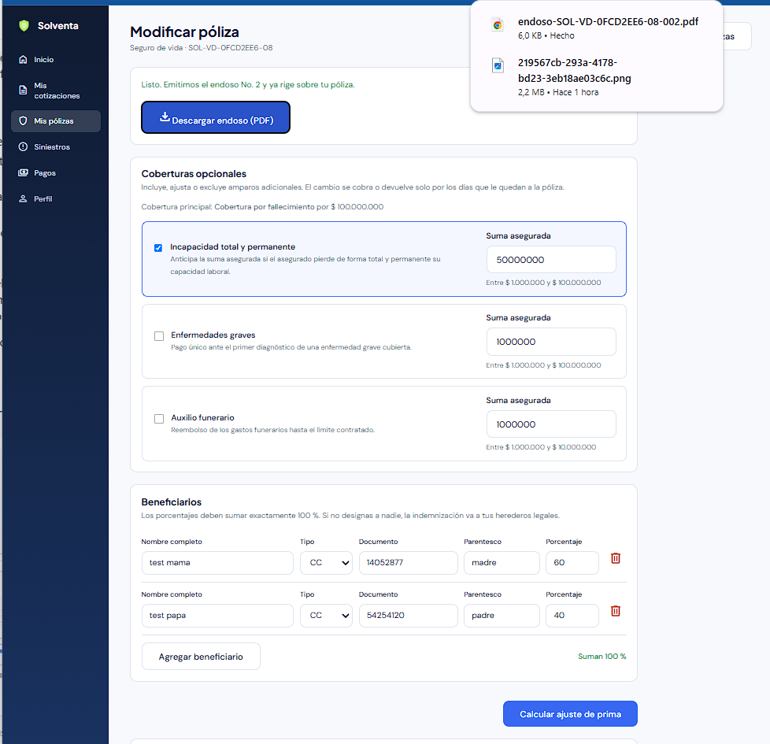

### 10. Documento del endoso

Anexo con los cambios, las coberturas vigentes, los beneficiarios, el ajuste de prima y la huella de la solicitud. El PDF original de la póliza no se modifica.

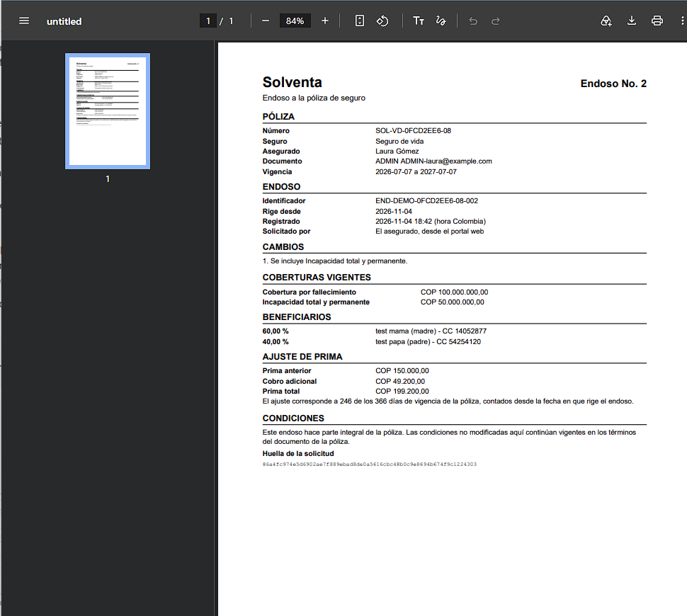

### 11. Póliza de otro ramo

En un seguro de viaje se ofrecen sus propias coberturas opcionales y no aparece la sección de beneficiarios.

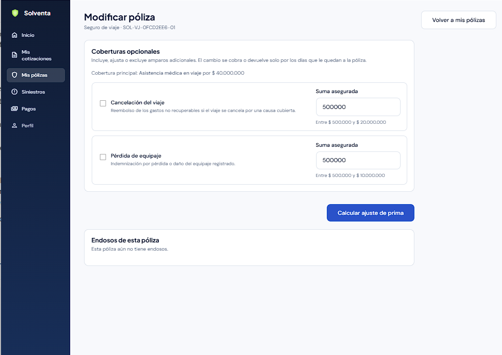
