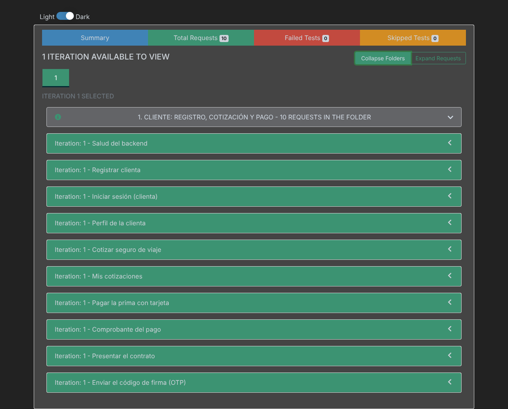
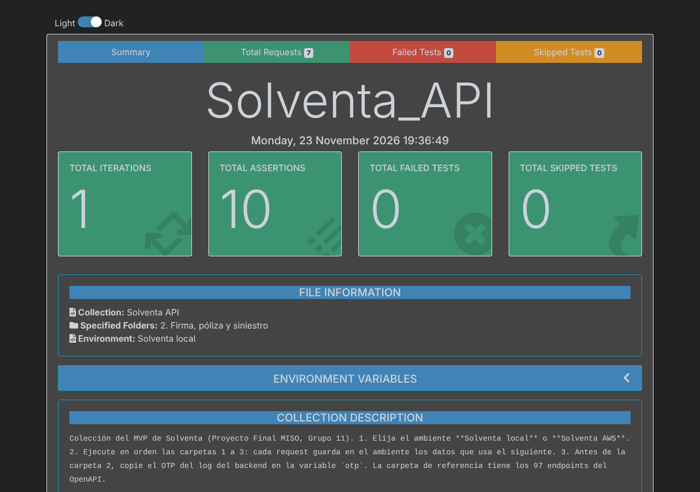
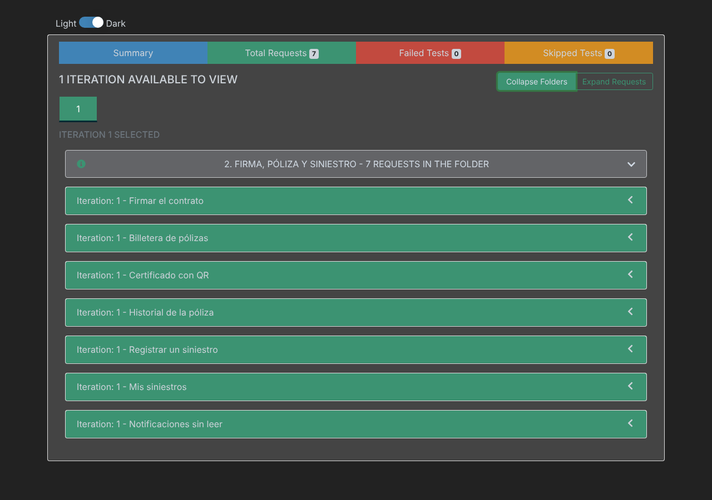
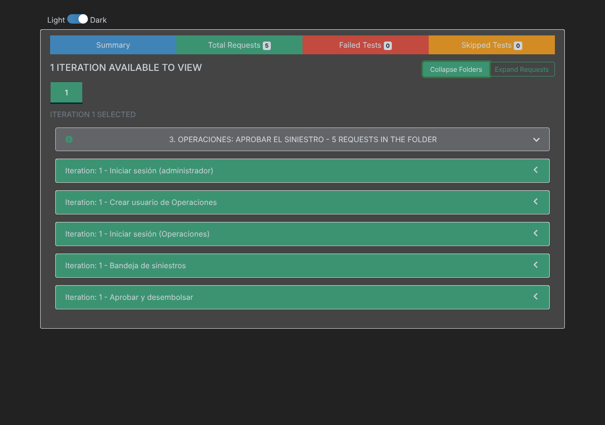

# Evidencias de la colección Postman

Ejecución del 23 de noviembre de 2026 de `postman/Solventa.postman_collection.json` con Newman contra
el backend local (ambiente *Solventa local*), usando `postman/ejecutar-flujo.sh`.

## Resultado

| Fase (carpeta) | Requests | Aserciones | Fallas |
| --- | ---: | ---: | ---: |
| 1. Cliente: registro, cotización y pago | 10 | 16 | 0 |
| 2. Firma, póliza y siniestro | 7 | 10 | 0 |
| 3. Operaciones: aprobar el siniestro | 5 | 8 | 0 |
| **Total** | **22** | **34** | **0** |

El flujo recorre el MVP de punta a punta: registro y KYC, cotización, aceptación, pago, firma con OTP,
emisión de la póliza, reporte del siniestro y aprobación por el analista de operaciones.

## Reportes

| Fase | Resumen | Requests | Reporte HTML |
| --- | --- | --- | --- |
| 1. Cliente |  |  | [reporte-1-cliente.html](reporte-1-cliente.html) |
| 2. Firma y siniestro |  |  | [reporte-2-firma-siniestro.html](reporte-2-firma-siniestro.html) |
| 3. Operaciones |  |  | [reporte-3-operaciones.html](reporte-3-operaciones.html) |

- [ejecucion-flujo-local.txt](ejecucion-flujo-local.txt): salida de consola de Newman con cada request,
  su código de respuesta y sus aserciones.
- Los reportes HTML se generaron con `newman-reporter-htmlextra`; los tokens del ambiente se
  reemplazaron por `[token omitido]`. Para verlos, descárguelos y ábralos en el navegador.

## Cómo repetirlo

```bash
npm install -g newman newman-reporter-htmlextra
BACKEND_LOG=/tmp/backend.log ./postman/ejecutar-flujo.sh            # local
ADMIN_PASSWORD='...' LOG_GROUP=<grupo-de-logs> BASE_URL=https://<cloudfront> ./postman/ejecutar-flujo.sh aws  # AWS (OTP desde CloudWatch)
```

Para el reporte HTML, agregue `-r cli,htmlextra --reporter-htmlextra-export reporte.html` al comando
`newman run`. Instrucciones completas en [postman/README.md](../../../postman/README.md).
